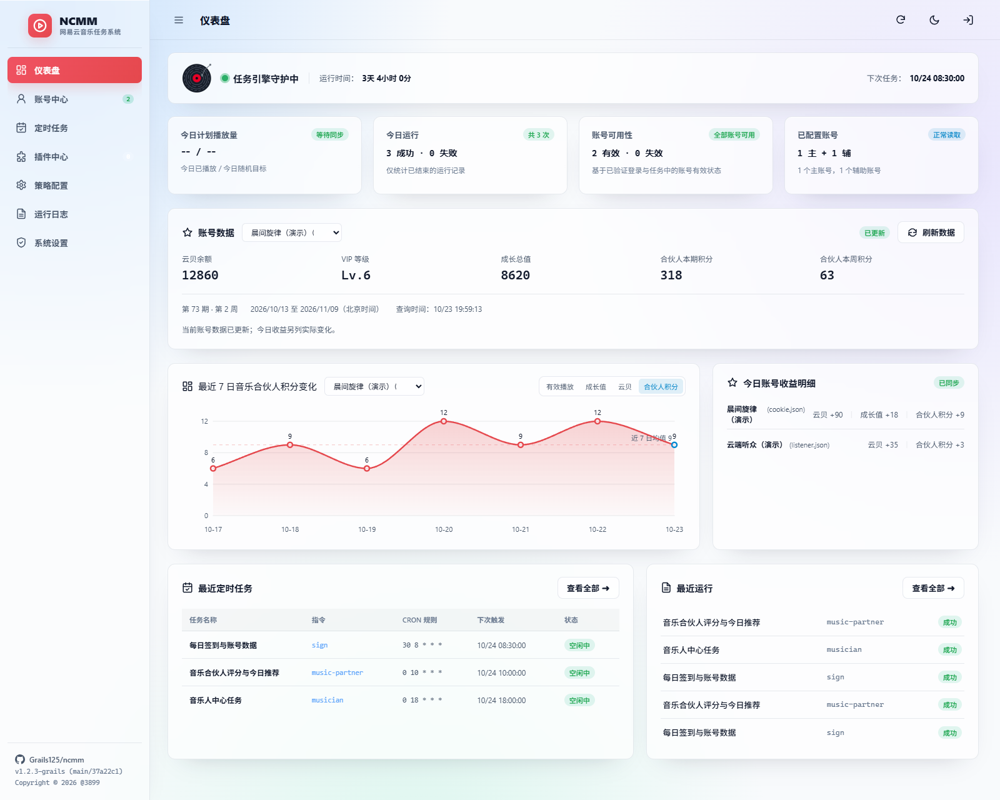
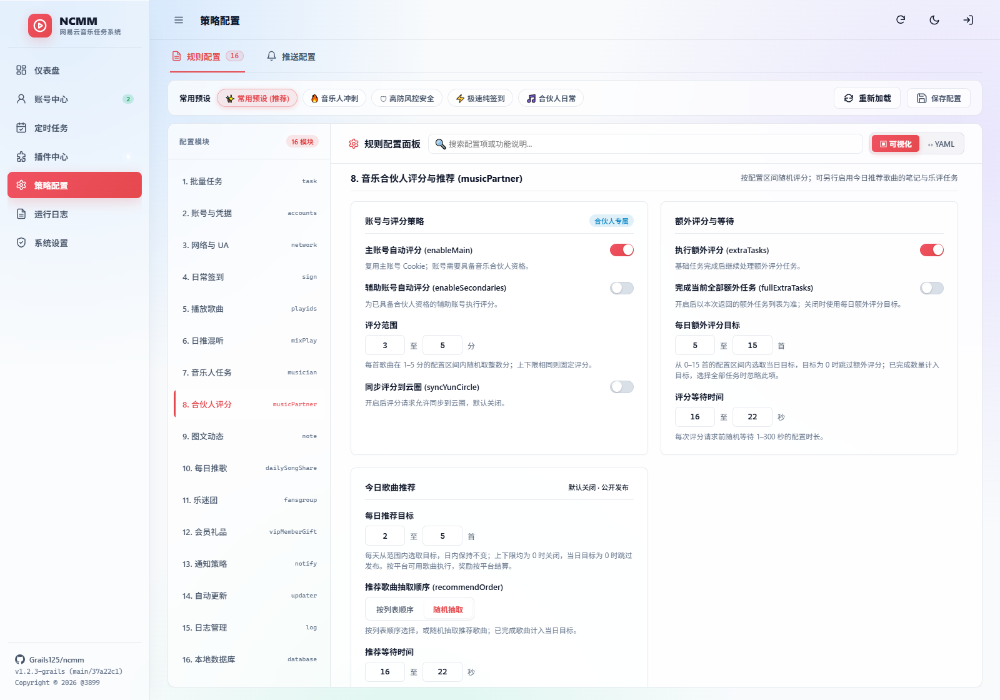
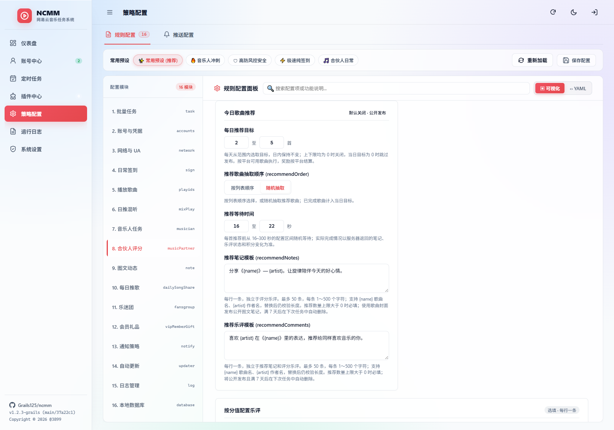

# 🎵 NCMM · 网易云音乐任务管理

基于 Go 的网易云音乐多账号自动化工具，提供 WebUI 与命令行。**音乐合伙人评分、今日推荐歌曲的试听上报、图文笔记与乐评均原生集成**，共用账号、配置、定时任务、日志和通知，无需评分插件或 Python 桌面程序。

当前已发布 **[v1.2.8-grails](https://github.com/Grails125/ncmm/releases/tag/v1.2.8-grails)**，提供 Windows / Linux 程序包和 Docker 镜像 `ghcr.io/grails125/ncmm:1.2.8-grails`。

## 核心功能

- **音乐合伙人评分**：基础与额外评分、主副账号选择、分数与每日额外目标范围、随机等待、各分值乐评模板、作品名日志和评分前后积分变化。
- **今日推荐歌曲任务**：每日数量范围、按列表顺序或随机抽取、试听上报、独立笔记与乐评模板，支持 `{name}` / `{artist}` 占位符；记录发布回执和平台进度，恢复未完成步骤。
- **WebUI 多账号管理**：二维码、Cookie、手机号和 CookieCloud 登录，集中管理任务、配置、运行日志和系统状态，支持明暗主题与移动端页面。
- **账号数据与收益**：当前云贝余额、VIP 等级、成长总值、合伙人本期和本周积分；今日收益只显示变化，最近 7 日可查看有效播放、云贝、成长值和合伙人积分变化。
- **任务与调度**：签到、云贝、成长值、音乐人、歌曲播放、图文动态、每日推歌、会员礼品与乐迷团任务；支持批量或独立执行、cron 计划和失败通知。
- **部署与数据管理**：Docker、Windows / Linux 单文件程序、配置备份与迁移、`--home` 实例隔离。

任务是否可完成取决于账号资格、登录状态及平台接口与额度；收益以平台返回的实际进度和积分为准。完整评分与推荐规则见 [音乐合伙人说明](docs/music-partner.md)。

## 快速上手

### Docker：使用已发布镜像

镜像支持 `linux/amd64` 和 `linux/arm64`。在独立目录创建 `compose.release.yaml`：

```yaml
services:
  ncmm:
    image: ghcr.io/grails125/ncmm:1.2.8-grails
    restart: unless-stopped
    ports:
      - "127.0.0.1:3899:3899"
    volumes:
      - ./data:/data
    environment:
      TZ: Asia/Shanghai
      NCMM_UPDATER_AUTO_UPDATE: "false"
      CRON_1: "30 8 * * * task"
```

```bash
docker compose -f compose.release.yaml up -d
docker compose -f compose.release.yaml logs -f ncmm
```

访问 [http://127.0.0.1:3899](http://127.0.0.1:3899)。`./data` 持久化配置、账号、认证和任务记录，一个数据目录只交给一个实例使用。上面的计划每天北京时间 08:30 执行已启用的批量任务，容器启动不会立即执行全部任务。若改用 WebUI 创建计划，删除 `CRON_1` 后重建容器，避免重复调度。

默认只在宿主机本地开放端口；服务器访问可使用 SSH 转发或 HTTPS 反向代理。详见 [Docker 部署](docs/docker.md) 和 [容器运行时](docs/docker-runtime.md)。

### Windows / Linux：下载程序包

从 [v1.2.8-grails 发布页](https://github.com/Grails125/ncmm/releases/tag/v1.2.8-grails) 选择对应架构并完整解压：

| 平台 | 下载 |
| --- | --- |
| Windows x64 | [ncmm_Windows_x86_64.zip](https://github.com/Grails125/ncmm/releases/download/v1.2.8-grails/ncmm_Windows_x86_64.zip) |
| Windows ARM64 | [ncmm_Windows_arm64.zip](https://github.com/Grails125/ncmm/releases/download/v1.2.8-grails/ncmm_Windows_arm64.zip) |
| Linux x64 | [ncmm_Linux_x86_64.tar.gz](https://github.com/Grails125/ncmm/releases/download/v1.2.8-grails/ncmm_Linux_x86_64.tar.gz) |
| Linux ARM64 | [ncmm_Linux_arm64.tar.gz](https://github.com/Grails125/ncmm/releases/download/v1.2.8-grails/ncmm_Linux_arm64.tar.gz) |
| Linux ARMv6 | [ncmm_Linux_armv6.tar.gz](https://github.com/Grails125/ncmm/releases/download/v1.2.8-grails/ncmm_Linux_armv6.tar.gz) |

发布页提供 [SHA256SUMS](https://github.com/Grails125/ncmm/releases/download/v1.2.8-grails/SHA256SUMS) 用于核对下载文件。

Windows 双击 `一键启动.bat`，启动后自动打开 WebUI；停止时使用同目录的 `一键停止.bat`。它们以解压目录保存数据，详见 [Windows 运行指南](docs/windows.md)。

Linux 在解压目录执行：

```bash
chmod +x ./ncmm
./ncmm --home . web
```

### 首次配置

1. 打开 WebUI 设置管理员密码，在“账号中心”登录主账号或辅助账号。
2. 在“策略配置”选择需要的任务。启用音乐合伙人需开启 `task.music-partner`，确认账号资格和评分范围；额外评分默认每天累计目标为 5–15 首，可配置范围为 0–15。
3. 推荐歌曲默认数量为 `0–0`，表示关闭新增推荐。启用时配置每日数量范围、顺序或随机抽取，以及独立的笔记和乐评模板；数量不固定限制为 3 首，实际执行受平台可用歌曲限制。
4. 先从任务页单独运行所需任务并查看日志，再配置日常计划。已有批量计划包含该任务时，无需另建重复规则。

推荐任务会获取音频、按配置等待并上报试听，随后发布歌曲封面的图文笔记与乐评；等待本身不等于平台判定完成。内容公开发布，至少保留 7 天，到期后在下次音乐合伙人任务中清理本功能记录的内容；不会删除手动发布的内容。详情见 [推荐歌曲配置与执行规则](docs/music-partner.md#今日推荐歌曲笔记与乐评)。

### 命令行与源码构建

已配置账号后可单独运行任务，`--home` 应与 WebUI 使用同一数据目录；执行前确认该账号没有正在运行的任务：

```bash
./ncmm --home . music-partner
./ncmm --home . task
```

普通任务命令不会启动 WebUI。多实例请显式指定不同的 `--home`；相对 Cookie、数据库和日志路径以选定 home 为基准。配置发现、路径优先级与登录参数见 [命令行说明](docs/cli.md)。

需要自行构建时，仓库根目录的 `docker-compose.yml` 使用本地源码构建 `ncmm-native:local`，与上面的发布镜像配置分别使用：

```bash
git clone --branch main https://github.com/Grails125/ncmm.git
cd ncmm
docker compose up -d --build
```

## 升级与源码基线

升级前停止任务并备份整个数据目录。使用发布镜像时修改 `compose.release.yaml` 中的版本标签，再执行 `docker compose -f compose.release.yaml pull` 和 `docker compose -f compose.release.yaml up -d`；原有 `/data` 挂载继续保留。

新版本统一使用 `x.x.x-grails`，继续兼容历史 `x.x.x-grails.N` 配置与版本。旧 `1.2.2-grails.1` 程序及旧安装脚本不能识别新后缀，首次升级需手动替换为本仓库的新程序包或重建容器；后续可使用新版内置更新器。迁移、备份恢复和受管容器更新见 [更新与发布说明](docs/native-updates.md)。

本分支从公开 fork 恢复 **NCMM v1.2.2 完整源码**，并在此基础上集成原生音乐合伙人功能、补齐可核对的后续行为。上游 v1.2.9 的对应完整源码未公开，因此不宣称包含其全部功能或修复。跨分支迁移请保留原程序与数据备份，并先在独立目录验证。详见 [源码基线](docs/source-baseline.md)、[1.2.9 兼容性说明](docs/v129-compatibility.md) 与 [第三方许可](THIRD_PARTY_NOTICES.md)。

---

## 🖼️ WebUI 预览

以下为当前 WebUI 的实际界面，账号、收益和任务记录均使用合成演示数据。



<table>
  <tr>
    <td width="50%"><strong>原生音乐合伙人评分</strong><br/></td>
    <td width="50%"><strong>今日推荐笔记与乐评</strong><br/></td>
  </tr>
</table>

[查看完整功能说明与界面预览](docs/webui.md)

---

## 📚 详细文档

为了获得更好的阅读体验，本项目的详细使用手册已拆分为以下子文档：

* 🖥️ [WebUI 使用说明](docs/webui.md) — 启动方式、账号管理、定时任务、安全设置和完整界面预览。
* ⚙️ [配置文件详解](docs/configuration.md) — 了解 `config.yaml` 详细配置字段及各项任务开关说明。
* 🔔 [失败通知](docs/notify.md) — 运行失败汇总推送（Webhook / Bark / TG / 钉钉等，通道配置独立 `notify.yaml`）。
* 🪟 [Windows 运行指南](docs/windows.md) — 了解 Windows 前台运行、无窗口一键启动和停止方式。
* 🐳 [Docker 部署指南](docs/docker.md) — 了解如何通过 Docker/Docker Compose 一键部署并配合定时任务运行。
* 🐲 [青龙 / 呆呆面板部署指南](docs/qinglong.md) — 了解如何在青龙面板（Qinglong）与呆呆面板（Dumb-Panel）中订阅部署并配置自动化打卡任务。
* 📖 [命令行使用说明](docs/cli.md) — 查看完整的命令树、通用参数以及所有子命令的使用实例。
* 👥 [多账号隔离最佳实践](docs/multi-accounts.md) — 使用 `--home` 管理实例、配置与多账号数据。
* 📝 [版本更新记录](docs/changelog.md) — 查看历史版本的新增功能、架构优化与 Bug 修复记录。
* 🔄 [本分支的更新与发布](docs/native-updates.md) — 一键更新、备份恢复及固定提交的发布质量门禁。

---

## ⚠️ 免责声明

本项目仅供学术研究和 Golang 学习探讨之用，请勿用于任何商业用途或违反网易云音乐服务条款的行为。对于使用本项目带来的任何账号封禁、数据丢失等不良后果，由使用者自行承担，本项目不提供任何连带保证。

---

## 🎖️ 鸣谢

### 👥 贡献者

感谢大家为 ncmm 做出的宝贵贡献！欢迎通过 Issues 反馈问题与建议。

<a href="https://github.com/Grails125/ncmm/graphs/contributors">
  
</a>

### 🌱 社区支持

[LINUX DO](https://linux.do/)

### 📦 参考项目
| 项目 | 说明 |
| :--- | :--- |
| [chaunsin/netease-cloud-music](https://github.com/chaunsin/netease-cloud-music) | 网易云音乐 API |
| [crossgg/netease-cloud-music](https://github.com/crossgg/netease-cloud-music) | 网易云音乐人任务 |
| [NeteaseCloudMusicApiEnhanced/api-enhanced](https://github.com/NeteaseCloudMusicApiEnhanced/api-enhanced) | 网易云音乐API接口 |
| 所有依赖的开源项目 | |
